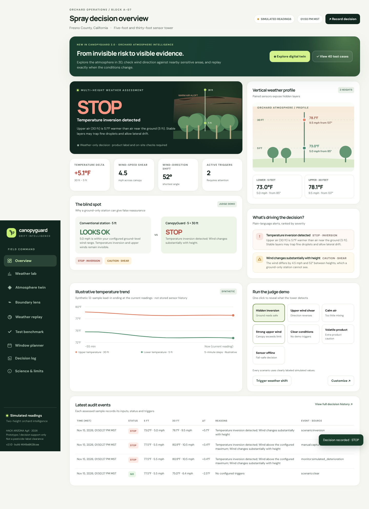

# CanopyGuard 2.1 — Orchard Drift Intelligence

A field-first, explainable, two-height **weather screening** prototype for Hack Arizona AgX's **Spray or Wait?** challenge.
A single 5-ft station can say "wind looks fine" while warmer air 30 ft up — an inversion — says stop. CanopyGuard compares
both heights, explains every GO / CAUTION / STOP in plain language, and keeps a timestamped, exportable log.

- **Public deployment (v2.1.0, current production):** https://canopyguard-agx-2026.vercel.app/
- **This release:** v2.1.0 — build id shown in the sidebar footer and in `<meta name="canopyguard-version">`.
- **Demo video:** `demo/CanopyGuard-Demo-3min.mp4` (2:50) · captions `demo/CanopyGuard-Demo-3min.srt` · transcript `demo/NARRATION.md`

> **Weather screening only.** GO means the configured weather checks pass. It is not spray authorization, does not replace the
> product label or local rules, and does not guarantee zero drift. All default readings are simulated.



## What is in the app

| Area | What it does |
|---|---|
| **Overview** | Hero verdict, ΔT / shear / direction metrics, the ground-only vs. two-height "blind spot" comparison, ranked reasons with codes, 7 simulated scenarios, a simulated weather shift, latest audit events. |
| **Weather lab** | Enter 5-ft / 30-ft temperature (°F), wind (mph), FROM direction (°), sensor age (min), volatility and wind limits; invalid fields are highlighted. Import a tower JSON file (sample file downloadable), reset to the demo anchor. |
| **Atmospheric twin** | Interactive perspective-3D orchard linked to the current readings: orbit (drag / arrows), zoom (wheel / +/−), pause, thermal-layer and tracer toggles, north marker, all active reasons. Arrows point downwind; readings are FROM. Tracers are illustrative. |
| **Boundary lens** | Schematic block with 5-ft and 30-ft TOWARD sectors (±29°) and four draggable (mouse, touch or keyboard) receptors. Map colour, list and count use one rule. Screening only — not a map, plume or exposure estimate. |
| **Weather replay** | 17 synthetic frames, 05:30–09:30: play (stops at the end and when you leave the page), scrub, timeline, apply a frame to the live dashboard (logged), export. |
| **Evidence lab** | The 40 labeled synthetic cases run live in the browser against the same engine: 40/40, 21 ground-blind, 23 STOP; filters by every category, computed ground-blind set, failures-only (with empty state); load any case; export results. |
| **Window planner** | Optional Open-Meteo regional forecast for Fresno (≈10 m wind, rain chance, times in PT). Before loading, or when offline, it shows clearly labelled placeholder hours — never fabricated "live" numbers. |
| **Decision log** | Browser-local, 300-entry rotating history with local time + zone, source (simulated / manual / imported), reasons and engine version; CSV (UTC, formula-injection safe) and JSON export, print, clear with confirmation. |
| **Science & limits** | Rules, provenance & units table (observed / configured / derived / illustrative), safety limits and sources. |

## Decision rules (src/js/engine.js — the single source of truth)

- **INVALID → STOP** if any critical value is missing, non-numeric, NaN/Infinity or implausible (−60–140 °F, 0–150 mph,
  0–360°), a sensor age is negative (future timestamp), max wind ≤ min wind, or volatility is unrecognised.
- **STOP:** either sensor older than 10 min (STALE) · upper warmer than lower, ΔT > 0 (INVERSION) · wind at either height
  below min (LOW_WIND) or above max (HIGH_WIND); limits are inclusive, default 3–10 mph · speed gap ≥ 6 mph or direction
  difference ≥ 90° (SEVERE_SHEAR).
- **CAUTION:** speed gap ≥ 4 mph or direction difference ≥ 45° (SHEAR) · medium/high product volatility (VOLATILITY).
- **GO:** no configured trigger fired.
- Direction differences are circular (359° vs 1° = 2°); values are rounded to 0.001 before comparison to remove
  floating-point noise.

3–10 mph is illustrative general guidance (UC IPM); shear and staleness thresholds are prototype heuristics, not regulatory
or validated values. Upper > lower flags a *potential* inversion; instrument accuracy and calibration are not modelled.

## Run it

Open `index.html` in any modern browser — it is one self-contained file and works offline (the Google font and the optional
forecast need a network; both degrade gracefully). Deep links work: `index.html#twin`, `#boundary`, `#replay`, `#log`, …

## Build and test (one command)

```bash
npm install                 # dev tools only: Playwright, axe-core, fonts for offline test fidelity
npx playwright install chromium   # only if Google Chrome is not installed
npm test                    # build check + engine suites + full browser E2E at 1440×900 and 390×844
```

| Command | What it checks |
|---|---|
| `npm run build` | Inlines `src/` + `validation-cases.json` into the deployable `index.html` (deterministic). |
| `npm run check:build` | Fails if `index.html` is not exactly what `src/` produces — prevents source/deploy drift. |
| `node validate-engine.cjs` | 40 synthetic cases against `src/js/engine.js`; also fails unless the engine inlined in `index.html` is byte-identical and the inlined cases equal the JSON. Expected: **40/40**, 21 ground-blind, 23 STOP. |
| `node tests/engine-edge.test.cjs` | 121 hand-written boundary/invalid-input tests plus a 20,000-input fuzz against an independent oracle. |
| `node tests/e2e.cjs` | 39 real-browser journeys (every page and control, imports, exports, offline forecast, storage failure, accessibility scan, touch drag, frame rate). Writes `qa/e2e-report.json` and `qa/screens/`. |

The 40 cases are synthetic, deterministic rule-specification examples. **40/40 shows the rules behave as specified on
constructed inputs — not field accuracy, sensitivity or precision.** The 21 ground-blind cases were constructed, not sampled.

## Project layout

```
index.html                  built, deployable single file (do not hand-edit)
src/index.html              markup template        src/js/engine.js       decision rules (browser + Node)
src/js/app.js               core UI, log, import, planner, navigation
src/js/enhancements.js      twin, boundary lens, replay, evidence lab
src/css/base.css, enhancements.css
validation-cases.json       40 synthetic labeled cases
validate-engine.cjs         benchmark + source/deploy parity check
tests/                      engine-edge.test.cjs, e2e.cjs, browser.cjs
tools/build.cjs             build / --check
demo/                       recorder, video, captions, narration
docs/                       QA report, release notes, deployment, screenshots
```

## Model / rules disclaimer

- Default orchard readings, scenarios, replay frames and benchmark cases are **simulated**; no sensor hardware is connected.
- Real product labels and regulations always take precedence over the configurable wind limits.
- Twin tracers, the thermal band, boundary sectors, receptor positions and the trend lead-in are explanatory graphics, **not**
  physics-based dispersion, deposition, exposure or concentration estimates.
- The decision log lives in this browser only: it is not shared, server-synchronized, tamper-evident or a regulatory record.
- Regional model forecasts are not orchard inversion observations.

## References

UC ANR, [Surface inversions cause spray drift](https://ucanr.edu/blog/topics-subtropics/article/surface-inversions-cause-spray-drift) ·
UC IPM, [Mitigating pesticide hazards](https://ipm.ucanr.edu/environmental-protection-and-pesticide-stewardship/mitigating-pesticide-hazards/) ·
US EPA, [Improving labels to reduce pesticide drift](https://www.epa.gov/reducing-pesticide-drift/improving-labels-reduce-pesticide-drift) ·
UC ANR, [Airblast Spray Advisor](https://ucanr.edu/site/airblast-spray-advisor) ·
Open-Meteo, [Forecast API](https://open-meteo.com/en/docs)

This is a hackathon prototype, not an agricultural application authorization system.
